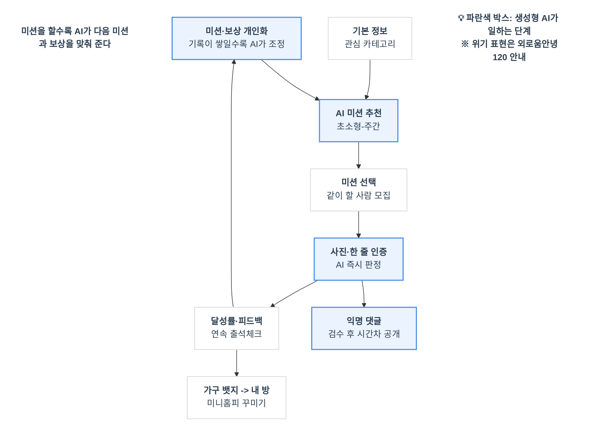

## 🏛️ '서울챌린지' 기획 구조화 및 보완안

기술스택
  
프론트: Expo(React Native) + Expo Router
백엔드: Supabase

AI: 제미나이 API

제안 배경

현재 정책, ‘외로움 없는 서울’

서울시는 이례적으로 ‘외로움’을 개인이 감당해야 할 ‘감정’이 아니라 도시가 함께 해결해야 할 ‘사회문제’로 보고 있다. 이러한 문제의식에서 2024년 10월 「외로움 없는 서울」을 발표하고, ‘외로움안녕120’, ‘서울마음편의점’, 서울형 사회적처방 등 다양한 사업을 추진해왔다.

2025년 4월부터 2026년 8월까지 ‘외로움안녕120’ 누적 상담은 8만여 건에 달했다. 누구나 편하게 들러 쉬고 교류하며 상담받을 수 있는 ‘서울마음편의점’도 같은 기간 누적 이용자 16만4천여 명을 기록했으며, 현재 19개소에서 올해 말까지 서울 전역 25개소로 확대할 예정이다.

시는 이러한 성과를 바탕으로 시민 참여 중심의 정책에서 한발 더 나아가, 일상에서 자연스럽게 사람과 관계를 맺을 수 있는 ‘공간’으로 외로움 정책을 확장했다고 설명했다.

** 긴급, 시급X. 고립, 은둔 전후 등 특정 타겟보다는 ‘외로움’이라는 키워드로 접근.

‘외로움’ ‘마음건강’등의 키워드가 주는 부담감 -> 진입장벽 허물기

지원은 '내가 외롭다'고 인정해야 시작되고, 20대의 49.6%는 만나서 무슨 말을 할지부터 걱정,

'외로움'이라는 말 없이 일상 챌린지로 들어오게 해서, 스스로 외롭다고 인정하지 않아도 시작할 수 있게 한다.

365 서울챌린지를 청년 맞춤으로 확장하고, 원할 때만 외로움안녕120·서울마음편의점·청년마음건강 지원사업을 안내.

### 1. 브랜드 & 디자인 톤앤매너 (앞서 논의한 UI 연계)

- **메인 컬러:** **세이지 그린(Sage Green)** + **소프트 웜 베이지(Warm Beige)**
- **디자인 콘셉트:** 차갑고 딱딱한 공공기관 앱이 아닌, **"언제든 편하게 쉬어가고 작은 성취를 쌓는 나만의 비밀 아지트"**
- **핵심 메시지:** _"외로우신가요?"_(X) $\rightarrow$ **"오늘 당신의 작은 하루를 응원해요"**(O)
### 2. 핵심 서비스 흐름 (UX Flow)
```
[1. 가벼운 온보딩] ──> [2. AI 개인화 미션] ──> [3. 즉시 인증 & 피드백] ──> [4. 보상 & 느슨한 연결]
 - 관심사/컨디션 선택     - 초소형/일일/주간 미션    - AI 즉시 판정            - 마이룸 가구 수집(뱃지)
 - 익명 프로필 생성        - 난이도 자동 조절        - 칭찬 메세지 & 포인트     - 시간차 익명 댓글/함께하기
```

#### ① 온보딩 (기본 정보 & 카테고리)

- **최소한의 진입 장벽:** 복잡한 본인 인증 후, '사용가능한 시간'와 '관심 분야(산책, 카페, 독서, 사진 등)'만 가볍게 선택.
#### ② 초소형(Micro) 미션 체계 (나에게 맞는 첫 계단)
- AI를 통해 개인 맞춤 미션부여
- **초소형 미션 :** _"창문 열고 하늘 사진 찍기"_, _"물 한 잔 마시기"_, _"집 앞 편의점 다녀오기"_ 등등
- **일일 미션 :** _"동네 산책로 15분 걷기"_, _"자주 가는 카페 사진 남기기"_ 등등
- **주간/함께 미션 :** _"동네 책방 방문하기"_, _"주말 한강 공원 플로깅"_, _"같은 미션 수행자들과 온·오프라인 소모임"_ 등등
    
#### ③ 즉시 피드백 & 보상 시스템 (보상의 다양화)

- **AI 즉시 인증:** 사진 업로드 즉시 AI가 인식해 "오늘도 해내셨군요! 정오의 햇살이 정말 따뜻해 보여요."와 같은 **따뜻한 즉시 피드백** 제공.
- **마이룸(가구) 수집 시스템 (미니홈피 감성):**
    - 단순 뱃지 대신, **'나만의 작은 방(마이룸)'을 꾸밀 수 있는 입체적인 가구/소품 아이템** 지급.
    - 초소형 미션 완료 시 '화분', '조명', '러그' 등을 얻어 방을 꾸미는 재미(시각적·소장 욕구 자극).

#### ④ 느슨하고 안전한 연결 (익명 커뮤니티)

- **시간차 비동기 댓글 (안전지대 구축):** 실시간 채팅의 부담감을 없애고, 몇 분 뒤에 전달되는 따뜻한 응원 댓글 시스템.
- **'함께하기' 버튼:** 같은 지역/미션을 수행 중인 유저에게 "저도 이 미션 했어요!" 식의 부담 없는 탭 한 번으로 연결감 형성.
    

### 3. 기획서 보완을 위한 3가지 키 아이디어 (제안)

1. **'여유 시간' 기반 미션 추천:**
    - 사용자가 매일 아침 "여유 시간은 5분이야"라고 설정하면, 앱이 알아서 부담 없는 '초소형 미션'만 추천해 주어 실패로 인한 자괴감을 방지합니다.
        
2. **자연스러운 정책 연결 (스텔스 탭):**
    - 설정 한쪽에 "마음 휴게소"라는 이름으로 서울시 마음건강 사업(서울마음편의점, 외로움안녕120 등)을 부담스럽지 않게 배치합니다.




익